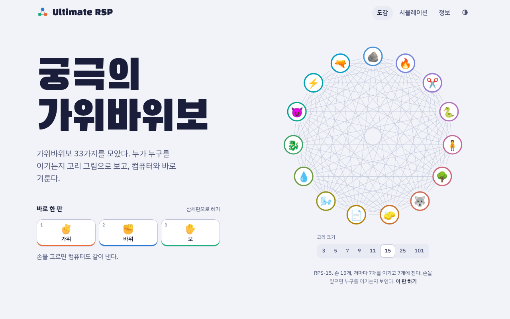
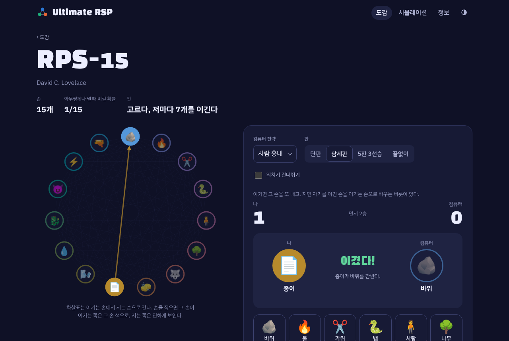
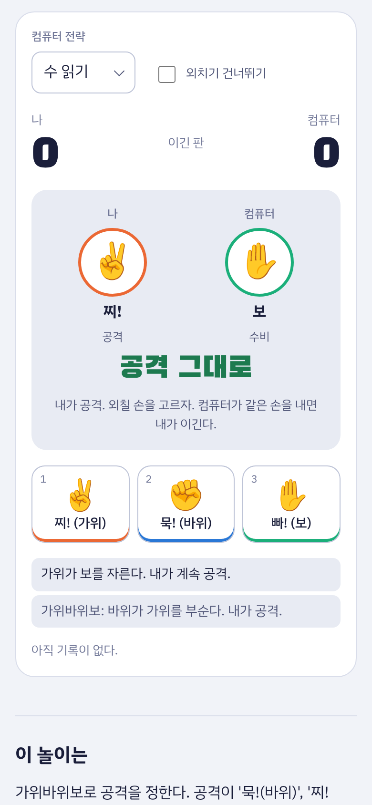
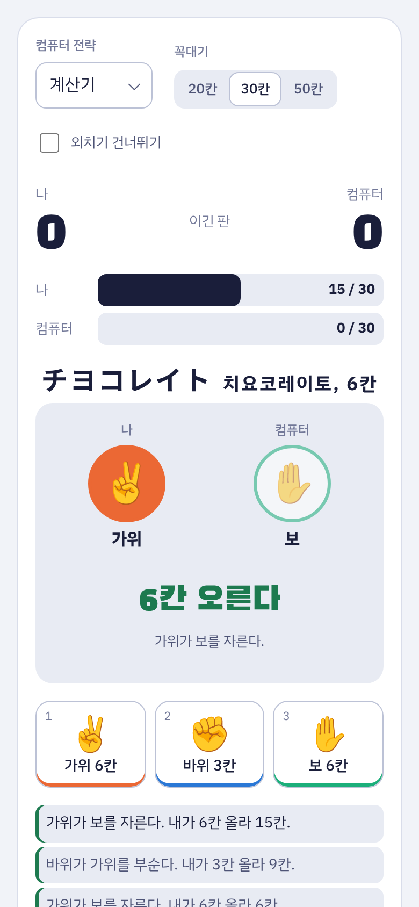
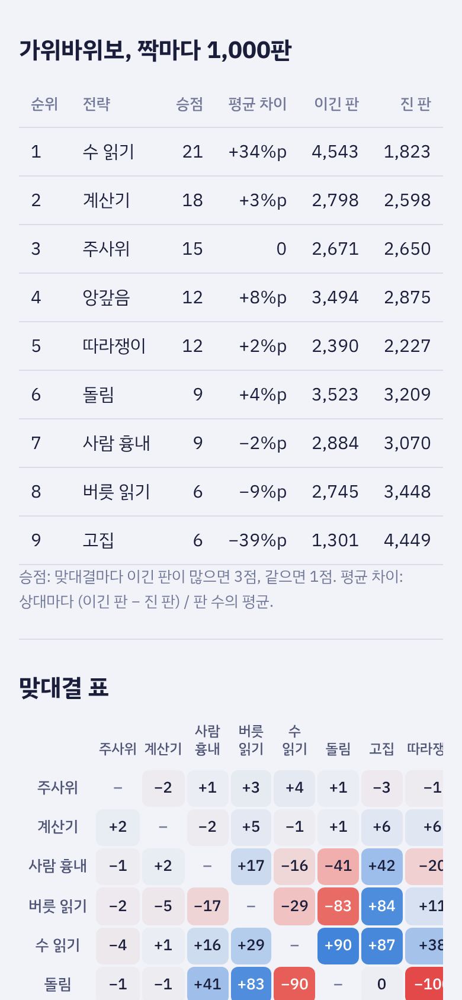
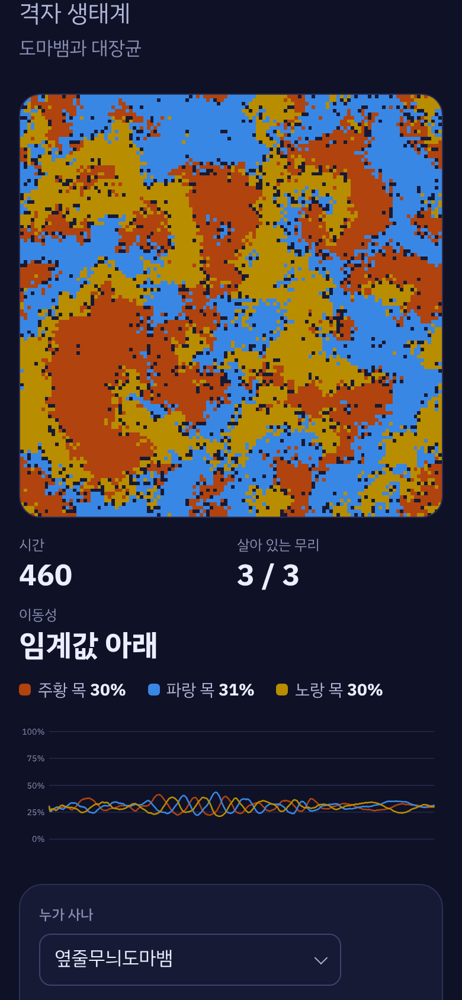

<h1 align="center">Ultimate RSP</h1>

<p align="center">
  궁극의 가위바위보<br>
  The Ultimate Rock Paper Scissors (한국어, English)<br>
  <a href="https://archi142857.github.io/ultimate-rsp/"><b>웹에서 바로 하기</b></a>
</p>

<p align="center">
  
</p>

가위바위보와 그 변종 33가지를 모아 둔 웹 앱입니다. 일본의 옛 손 놀이인 무시켄과 키츠네켄, 손이 101개인 RPS-101, 묵찌빠와 하나빼기 같은 놀이까지 규칙을 읽고 바로 컴퓨터와 겨뤄 볼 수 있습니다. 컴퓨터 전략끼리 수천 판을 붙여 보거나, 가위바위보처럼 서로 물고 무는 생물이 어떻게 함께 사는지 시뮬레이션으로 볼 수도 있습니다.

## 쓰는 법

1. `도감`에서 해 보고 싶은 가위바위보를 고릅니다.
2. 컴퓨터 전략과 판 수(단판, 삼세판, 5판 3선승, 끝없이)를 정하고 손을 냅니다. 숫자 키 1, 2, 3…으로도 냅니다.
3. `시뮬레이션`에서 전략 리그, 격자 생태계, 가위바위보 전쟁을 돌려 봅니다.

## 할 수 있는 것

### 도감

<p align="center">
  
</p>

- 셋이 물고 무는 꼴 8가지: 가위바위보, 무시켄, 키츠네켄, 토라켄, 수트(개미·사람·코끼리), 새·물·돌, 곰·사냥꾼·닌자, 호랑이·막대기·닭.
- 손을 더한 꼴 12가지: 우물, 다이너마이트, 불과 물, 막대기·호랑이·닭·벌레, 가위바위보 도마뱀 스팍, RPS-7·9·11·15·25·101. 손 개수(3–101개)와 이기는 개수를 정해 `직접 만들기`로 새 판을 만들 수도 있습니다.
- 변종마다 누가 누구를 이기는지 고리 그림으로 보여 줍니다. 손을 짚으면 그 손이 이기는 쪽과 지는 쪽이 드러나고, 판을 할 때마다 이긴 손에서 진 손으로 화살표가 그어집니다.
- 손이 고르지 않은 판은 최적 섞기를 계산해 보여 줍니다. 우물에서는 바위를, 다이너마이트에서는 보를 아예 내지 않는 것이 최선입니다.
- 판정은 "종이가 바위를 감싼다"처럼 문장으로 알려 줍니다. 손 이름에 맞춰 조사(이/가, 을/를)를 붙입니다. 영어판에서는 "Paper wraps rock"처럼 나옵니다.

### 가위바위보 위에 쌓은 놀이, 여럿이 하는 놀이

<p align="center">
  
  &nbsp;
  
</p>

- 묵찌빠, 아치무이테호이, 하나빼기, 글리코, 한정 가위바위보(카드 12장과 별 3개), 다이너마이트와 물풍선, 명령 가위바위보(30초 동안 이겨라·져라·비겨라).
- 여럿이 가위바위보(3–10명), 가위바위보 기차, 진화 가위바위보(알·병아리·닭·공룡·왕).
- 글리코와 한정 가위바위보는 컴퓨터가 남은 칸이나 남은 카드를 보고 계산한 최선의 섞기대로 냅니다.

### 컴퓨터 전략

컴퓨터는 9가지 전략 가운데 하나로 냅니다.

| 전략 | 어떻게 내나 |
| --- | --- |
| 주사위 | 아무 손이나 같은 확률로 낸다 |
| 계산기 | 최적 섞기대로 낸다. 길게 보면 누구에게도 지지 않는다 |
| 사람 흉내 | 이기면 그 손을 또 내고, 지면 자기를 이긴 손을 이기는 손으로 바꾸는 버릇이 있다 |
| 버릇 읽기 | 상대가 요즘 자주 내는 손을 노린다 |
| 수 읽기 | 상대가 내 온 차례를 외워서 다음 손을 짐작한다 |
| 돌림 | 고리 차례대로 돌아가며 낸다 |
| 고집 | 한 손만 고집한다 |
| 따라쟁이 | 상대가 방금 낸 손을 따라 낸다 |
| 앙갚음 | 상대가 방금 낸 손을 이기는 손을 낸다 |

### 시뮬레이션

<p align="center">
  
  &nbsp;
  
</p>

- 전략 리그: 고른 전략들이 짝마다 100–10,000판씩 겨룹니다. 순위표와 맞대결 표를 보여 주고, 전략끼리 생긴 물고 무는 고리(돌림 → 앙갚음 → 따라쟁이 → 돌림 같은)를 찾아 줍니다.
- 자연 속 가위바위보: 옆줄무늬도마뱀과 대장균처럼 서로 물고 무는 무리를 격자 위에 놓고 돌립니다. 이동성을 바꾸면 셋이 얼룩과 소용돌이를 이루며 함께 살다가, 임계값(약 4.5 × 10⁻⁴)을 넘으면 한 무리만 남습니다. 잘 섞인 물속처럼 아무 칸끼리나 만나게 할 수도 있습니다.
- 가위바위보 전쟁: 가위·바위·보가 판 위를 떠돌다 부딪히면 진 쪽이 이긴 쪽으로 바뀝니다. 한 가지만 남을 때까지 지켜봅니다.

### 그 밖에

- 화면 언어는 한국어와 영어 가운데 고릅니다. 위쪽 `EN`/`한` 단추로 바꾸고, 처음 열 때는 브라우저 언어를 따릅니다. 변종 이름과 설명, 판정 문장, 놀이 안내까지 모두 바뀝니다.
- 테마는 기기 설정, 라이트, 다크 가운데 고릅니다.
- 가입이 필요 없습니다. 전적과 설정은 이 브라우저에만 저장됩니다.
- 키보드만으로 다 할 수 있고, 판 결과를 스크린리더가 읽어 줍니다. 기기에서 움직임 줄이기를 켜면 애니메이션을 줄입니다.

## 계산은 이렇게 합니다

- 변종마다 손과 '누가 누구를 이기는지'만 적으면 판정표가 만들어집니다. RPS-7부터 RPS-101까지와 `직접 만들기`는 손을 고리로 늘어놓고 손마다 그 뒤로 몇 개를 이긴다는 규칙 하나로 만듭니다.
- 최적 섞기는 판정표를 영합 게임으로 보고 선형 계획법(심플렉스)으로 풉니다. 모든 손을 똑같이 섞어도 지지 않는 판이면 그것을 그대로 보여 줍니다.
- 묵찌빠에서 둘 다 아무렇게나 내면 공격하는 쪽이 이길 확률은 2/3입니다. 하나빼기에서는 서로 다른 두 손 짝 셋을 1/3씩 내는 것이 최선입니다.
- 글리코는 꼭대기까지 남은 칸 수마다 이길 확률을 가치 반복으로 풉니다. 둘 다 꼭대기에서 멀 때는 바위와 가위를 40%씩, 보를 20% 내는 것이 최선에 가깝습니다.
- 한정 가위바위보는 남은 카드와 별로 나뉘는 형편(처음부터 2,626가지)마다 영합 게임을 풀어 거꾸로 올라갑니다.
- 여럿이 가위바위보에서 n명이 아무렇게나 낼 때 한 번에 승부가 날 확률은 3(2ⁿ − 2)/3ⁿ입니다. 8명이면 12%쯤입니다.
- 격자 생태계는 Reichenbach, Mobilia & Frey(2007)의 모형입니다. 칸마다 한 개체가 살거나 비어 있고, 이웃 둘을 골라 고르기(이긴 쪽이 진 쪽을 없앤다), 번식(빈칸에 퍼진다), 자리 바꾸기 가운데 하나가 일어납니다. 이동성은 M = 2ε/N입니다.

변종마다 규칙과 출처는 [docs/variants.md](docs/variants.md)에 정리해 두었습니다.

## 직접 돌려 보기

```
python -m http.server 8000 -d web                  # http://localhost:8000 에서 웹 앱
node --test                                        # 테스트 (Node 20 이상)
node scripts/variants_doc.mjs > docs/variants.md   # 변종 목록 문서 다시 만들기
```

빌드 단계가 없습니다. `web/` 폴더가 그대로 웹 앱이고, 브라우저가 ES 모듈을 바로 불러옵니다. `index.html`을 더블클릭해서 열면 모듈을 불러오지 못하니 위처럼 간단한 서버로 엽니다.

<details>
<summary>폴더 구조</summary>

```
web/                          웹 앱 (GitHub Pages)
  index.html, style.css
  icons/                      파비콘
  art/                        손 그림 SVG (Fluent UI Emoji, 없는 손은 이모지)
  js/app.js                   주소(#/…)에 따라 화면을 고른다
  js/i18n.js, js/i18n/en.js   화면 언어(한국어·영어)와 영어 사전
  js/core/                    판정(engine), 최적 섞기(lp), 컴퓨터 전략(bots), 난수(rng), 조사(josa)
  js/data/                    도감(catalog), 도감 영어(catalog-en), RPS 확장판 판정 문장(verbs),
                              직접 만들기 손 모음(custom), 손 그림 목록(art-files)
  js/games/                   놀이 규칙: 판(match), 묵찌빠, 아치무이테호이, 하나빼기, 글리코,
                              한정 가위바위보, 다이너마이트와 물풍선, 명령, 여럿이·기차·진화(group)
  js/sims/                    전략 리그, 격자 생태계, 가위바위보 전쟁
  js/ui/                      DOM 도구, 색, 고리 그림, 손 그림(art), 저장, 공통 위젯
  js/views/                   화면
tests/                        node --test (판정, 최적 섞기, 놀이 규칙, 시뮬레이션, 손 그림, 영어판)
scripts/
  stamp.py                    배포할 때 스크립트·스타일 주소에 판(?v=)을 붙인다
  variants_doc.mjs            catalog.js → docs/variants.md
  art_list.mjs                web/art/ → js/data/art-files.js (그림 목록과 규격 검사)
docs/
  variants.md                 변종마다 규칙과 출처
  screenshots/                이 README 의 화면 캡처
.github/workflows/pages.yml   테스트하고 GitHub Pages 로 올린다
```

</details>

## 고칠 때 알아 둘 것

- 변종을 더하려면 `web/js/data/catalog.js`에 한 항목을 적습니다. 손과 `rel`(누가 누구를 어떻게 이기나) 또는 `cycle`(고리에서 뒤로 몇 개를 이기나)만 적으면 판정, 고리 그림, 최적 섞기, 플레이 화면이 따라옵니다. 그다음 `docs/variants.md`를 다시 만듭니다.
- 판 흐름이 있는 놀이는 규칙을 `js/games/`에, 화면을 `js/views/`에 나눠 둡니다. 규칙 쪽은 DOM 없이 돌아서 `node --test`로 시험합니다.
- 손 그림은 `js/ui/art.js` 한 곳에서 찍습니다. 손마다 그림 이름(`art`, 없으면 `id`)이 있고, `web/art/<그림 이름>.svg`가 있으면 그 그림을, 없으면 이모지를 씁니다. 그림은 Microsoft Fluent UI Emoji를 64×64 에 감싼 것이라 어느 기기에서나 같은 모양으로 보입니다. 그림을 넣거나 빼면 `node scripts/art_list.mjs`로 목록을 다시 만듭니다.
- 손 이름 뒤 조사는 `js/core/josa.js`의 `josa()`로 붙입니다. 받침에 따라 이/가, 을/를, 과/와, 으로/로를 고릅니다.
- 화면 글은 한국어 문장을 `t("{a:이가} {b:을를} 이긴다", { a, b })`처럼 감싸 씁니다. 영어는 `js/i18n/en.js`에 같은 한국어를 열쇠로 적고, 영어에서만 `{n|win|wins}`처럼 단수·복수를 고릅니다. 같은 한국어가 자리에 따라 영어로 달리 옮겨지면 `t("@stat:차례")`처럼 쓰임새를 붙입니다(한국어로 낼 때는 떨어집니다). 변종을 더하면 영어 이름과 설명, 판정 동사를 `js/data/catalog-en.js`에도 적습니다. 빠진 번역은 `tests/i18n.test.mjs`가 찾아냅니다.
- 손 색은 `js/ui/colors.js`의 팔레트를 순서대로 씁니다. 색각 이상에서도 이웃한 색이 구별되는지 검사한 순서라서 바꾸지 않습니다.
- `main`에 푸시하면 Actions가 테스트를 돌리고 `web/`을 GitHub Pages로 올립니다. 처음 한 번은 레포 Settings → Pages → Source를 `GitHub Actions`로 바꿔야 합니다.

## 라이선스

`LICENSE`(MIT)는 이 저장소의 **코드에만** 걸립니다.

| 무엇 | 조건 |
| --- | --- |
| 코드: `web/`, `scripts/`, `tests/` | MIT (`LICENSE`) |
| 글꼴: Black Han Sans, IBM Plex Sans KR. 저장소에 없고 jsDelivr의 Fontsource에서 불러옵니다 | SIL Open Font License 1.1 |
| 손 그림: `web/art/*.svg`. [Microsoft Fluent UI Emoji](https://github.com/microsoft/fluentui-emoji)를 64×64 에 감싼 것입니다. 아직 그림이 없는 손은 보는 기기의 이모지 글꼴로 그립니다 | MIT (© Microsoft Corporation). 고지문은 `web/art/LICENSE-fluentui-emoji.txt` |
| 놀이 규칙 | 놀이를 만든 사람과 전해 온 문화의 것입니다. RPS-7–101의 손 구성과 고리 순서는 David C. Lovelace([umop.com](https://www.umop.com/rps.htm))가 만들었습니다. 판정 문장과 설명은 이 앱에서 새로 썼습니다. 출처는 [docs/variants.md](docs/variants.md)에 있습니다 |
| 이름 `Ultimate RSP`, 아이콘(`web/icons/`), 화면 캡처(`docs/screenshots/`) | 라이선스를 주지 않습니다(MIT 대상이 아닙니다) |

## 만든 사람

서울대학교 동물생명공학전공 25학번 이영표 · sanger.lee138@gmail.com

버그 제보와 새 변종 제안은 [GitHub 이슈](https://github.com/Archi142857/ultimate-rsp/issues)에 남겨 주세요.
